<p align="center">
  <picture>
    <source media="(prefers-color-scheme: dark)" srcset="assets/logo-dark.svg">
    
  </picture>
</p>

<p align="center">
  <b>Cruise control for Claude Code: context warnings, a handoff button and per-prompt effort steering.</b><br>
  <a href="#install">Install</a> · <a href="#configure">Configure</a> · <a href="#laya-on-your-machine">Laya</a> · <a href="#research">Research</a> · <a href="#credits">Credits</a> · 
</p>

<p align="center">
  <picture>
    <source media="(prefers-color-scheme: dark)" srcset="assets/cruise-route-dark.svg">
    
  </picture>
</p>

## What it is

Cruise is a mod for Claude Code (its commands call mods "plugins") with four jobs. Each can be switched off.

| | What it does | Default |
| --- | --- | --- |
| **Context** | Warns at 60% and 80% of the context window and points to `/handoff`, before quality drops | on |
| **Handoff** | From the first warning, one row above the prompt with a button that saves the handoff, clears the conversation and picks up (or does it by itself, if you choose `auto`) | button |
| **Purser** | A short standing instruction that makes replies easy to follow and cheap to read: the result or next action first, numbered steps, and one status line on multi-step work (`Now · Done · Next`), like a purser's cabin announcement | on |
| **Effort** | A small judge reads each prompt and picks the lowest reasoning effort that still does the job, among `low`, `medium`, `high`, `xhigh`, `max` | on, judged by Haiku on your own login |

```text
Context 72% of 200K · » high (app medium) · h: Handoff and continue
```

The band above the prompt is one row, and only when there is something to say: the effort the judge picked, and from the first context warning the context and the button. `/cruise` opens the dashboard with everything else (context meter, handoff, effort, your latest request, plan step and background work, updates).

## Install

Cruise is not in Anthropic's directory; this repository is its own marketplace (`prestes`).

**Let Claude Code do it.** Paste this into Claude Code. It reads [`INSTALL.md`](INSTALL.md), installs the mod and asks a few short questions:

```text
Install Cruise from https://github.com/FranciscoPrestes/cruise and help me configure it.
```

**By hand:**

```text
/plugin marketplace add FranciscoPrestes/cruise
/plugin install cruise@prestes
```

Then `/reload-plugins` or open a new session. Check with `/cruise`, which shows what is on, the context gauge, what the judge is choosing and the update status.

## Configure

Run `/cruise:configure` (a short conversation) or `/plugin configure cruise@prestes`. Every option has a default.

| Setting | Default | What it does |
| --- | --- | --- |
| `context` | on | Context warnings |
| `warnAt` / `urgentAt` / `resetBelow` | 60 / 80 / 40 | First warning, urgent warning, and where warnings start over (%) |
| `contextAction` | `button` | When the context fills: `button` (a row above the prompt with a button that does handoff, clear and pickup), `alert` (warnings only) or `auto` (does all three by itself) |
| `autoAt` | 80 | Only with `auto`: the % of context at which it saves the handoff, clears and picks up by itself. Kept between the first warning and 95; 80 leaves room for the handoff itself. `/cruise` shows it as `auto at 80%` |
| `purser` | on | Purser mode: the short reply style above (about 500 tokens in the cached system prompt) |
| `minAskChars` | 25 | Shorter messages ("go ahead") do not replace the request shown |
| `effort` | `haiku` | The judge: `off`, `haiku`, `jev` or `laya` |
| `steer` | `both` | `both`: the judge may raise or lower your app's effort. `down`: only lower it |
| `topLevel` | `max` | Highest effort the judge may pick: `high`, `xhigh` or `max` |
| `routerModels` | empty (off) | Opt-in extra for people who run Claude Code through a router such as claude-code-router: comma-separated patterns (`*` wildcard, exact case) of the models whose effort Cruise may steer too, for example `OpenAI (Login)/gpt-*,Google (Login)/gemini-*`. Plain Claude Code is not affected. Read [`docs/router.md`](docs/router.md) before turning it on |
| `judgeUrl` / `judgeKey` / `judgeModel` | empty | Where a `jev` or `laya` judge listens, its key (kept in secure storage), and its model |
| `updates` | `check` | `check`: look on GitHub once a day and tell you; never install automatically. `off`: never look |

**Choose a judge**

| `effort` | Judge | Needs | What leaves your machine |
| --- | --- | --- | --- |
| `off` | none | nothing | nothing |
| `haiku` | Claude Haiku 5.5 on your own login | nothing | the next message and two small facts, to Anthropic |
| `jev` | TypeSafe Jev, hosted | a TypeSafe key | the same, **to TypeSafe** |
| `laya` | Laya, a small model on your machine | [setup below](#laya-on-your-machine) | nothing |

"Two small facts": the effort you are on, and whether the last reply ended with a question. **Cruise never sends the conversation to a judge.**

**Behaviour you can rely on.** The effort you set in the app is the starting point and wins if you change it. A judge that fails, is slow or is unsure leaves your setting alone. In plain Claude Code only Anthropic's own Opus, Sonnet and Fable 5 models are steered; Haiku, subagents and anything else are left alone, and the panel says so. Behind a router nothing is steered by default (see below); Cruise never translates effort into another provider's reasoning levels. Short follow-ups ("yes", "go") keep the current pick. If the prompt cache is ever rewritten after an effort change, steering stops for the session and says so. Ultracode (under `/effort`) cannot be switched by a mod; that stays your call.

**Through a router (opt-in, off by default).** Behind a router such as claude-code-router, models appear as `<Label> (Login)/<model>`. Cruise steers none of them unless you name them in `routerModels`, and it does **not** steer Anthropic ids behind a router either: measured, an effort change loses the prompt cache there (Anthropic, GPT and Gemini through one gateway), while plain Claude Code keeps it. Behind a router the Haiku judge is also not used until you set `judgeModel` to a model your router serves, because the bare Haiku name can be answered by another vendor when the Anthropic login is rate limited. The `jev` and `laya` judges do not go through the router. Everything else (context warnings, the handoff button, purser mode, `/cruise`) works with any model. The measurements, the judge trial and a direct comparison with Codex and Antigravity are in [`docs/router.md`](docs/router.md).

**Handoff button.** From the first warning, a row above the prompt reads `Context 72% of 200K · h: Handoff and continue`. Press it (or `h`, after `ctrl+x` then `tab` to focus the band) and Cruise runs `/handoff` as a turn, checks that the handoff file was really written, clears the conversation and runs `/pickup` in the fresh one. If the file is missing nothing is cleared. With `contextAction: auto` the same happens by itself, once per band, between turns, at `autoAt` (80 by default): it clears your conversation, so it is opt-in. `/cruise` shows the last run.

**Switching model.** Changing model with `/model` keeps the whole conversation, so nothing is reset. The context percentage is the last reply's tokens over the window of the model you are on, so a model with a smaller window shows a higher percentage for the same conversation; Cruise says which window it means (`Context 72% of 200K`) and, after a switch, warns again with the new figure. The first request on a new model also rewrites the prompt cache once.

**Skills.** `/handoff` saves the state of a session and `/pickup` resumes it in a fresh one (use `/cruise:handoff` if you have your own skills with those names). `/cruise:configure` sets Cruise up, `/cruise:update` installs a new version, `/cruise:setup-laya` installs Laya. Remove with `/plugin uninstall cruise@prestes`.

## Laya on your machine

Laya is a small open-source model (Apache 2.0) that answers in about 25 ms, offline, speaking the same protocol as Jev. **Use it only if you want a private, offline judge and are willing to train it on your own sessions first.** Untrained, or trained on invented prompts, it is not a judge to trust (numbers in [Research](#research)).

**1. Install** (about 1.5 GB of disk, 0.5 GB of memory, Python 3.10+ handled for you). Paste into Claude Code:

```text
Run the cruise:setup-laya skill. Tell me what it will download and how much disk and memory it needs, wait for my OK, and then install and configure everything.
```

The skill asks before every download, binds the server to `127.0.0.1` only (Laya listens on every interface by default), keeps everything under `~/.local/share/cruise/laya`, picks a free port (default 18787) and points `effort`, `judgeUrl` and `judgeModel` at it. Removing it is one folder.

**2. Train it on your own sessions** (about 20 minutes, US$ 0.30 to label 3,000 prompts with Haiku). Ask the same skill to do it, or run `train/` yourself ([`train/README.md`](train/README.md)). It reads your Claude Code history, has a Claude model label each prompt in hindsight, fine-tunes Laya, and scores it against Haiku on sessions it never saw, so you see the result before using it.

**Why not just download our trained model?** Our training data is our prompts: client names, code, private text. A model trained on it can reproduce parts of it, so neither is published, and no one else's would be either. Everything stays under `~/.local/share/cruise/laya-training` (mode 700), outside any repository. What this repository does ship is a set of about 1,550 *invented* prompts (`train/data/`, made by `train/make_synthetic.py`), which is useful for testing the pipeline but, as measured below, too different from real work to make a good judge by itself.

## Research

### Thesis

Most prompts do not need the effort they run at. If a cheap judge can tell a button-colour change from a repository-wide review, easy prompts can run lower, hard ones higher, and a long session gets cheaper or better. Three questions decide whether this is true: does changing effort break the prompt cache, can a judge pick the level, and does it pay.

### 1. Changing effort does not rewrite the cache

Anthropic's documentation says a top-level effort change invalidates the cache, while a per-message change (beta) preserves it on supported models. We alternated `low` and `high` on every request of a six-request task, Claude Code 2.1.306:

| Model | Cache read grew from → to (tokens) | New tokens written per request |
| --- | --- | --- |
| Sonnet 5.5 | 45,432 → 46,376 | about 100 |
| Opus 5.5 | 45,033 → 45,882 | about 78 |
| Fable 5.1 | 45,974 → 46,936 | about 103 |

The cache kept being read in all three. Limits: one trivial task per model, one run, and Bedrock and pre-5 Opus not measured. The built-in guard covers the rest. The probe is in `eval/cache-probe/`; run it on your setup.

### 2. Can a judge pick the level?

We labelled 2,796 prompts from 401 sessions of one person with all five levels: a Claude model sees each prompt *and* the work it set off, so a "fix this typo" that took 40 tool calls is not labelled `low`. Haiku 5.5 labelled for under US$ 0.30, Sonnet 5.5 for about US$ 4. Each judge was then scored on 619 prompts from 71 sessions it never saw (split by session, so nothing leaks), against Haiku's labels:

| Judge | Exact | Easy found | Hard found | False alarms | Mean level¹ |
| --- | --- | --- | --- | --- | --- |
| Always `medium` (do nothing) | 37% | 0% | 0% | 0% | 1.00 |
| **Haiku 5.5** with Cruise's 13 invented examples (`effort: haiku`) | 52% | 53% | 48% | 12% | 0.83 |
| Haiku 5.5 without the examples | 51% | 46% | 55% | 16% | 0.95 |
| **Laya trained on those sessions**, Cruise's rule | 48% | 44% | 11% | 6% | 0.78 |
| Laya trained on 1,200 *invented* prompts, Cruise's rule | 30% | 25% | 70% | 58% | 1.45 |

¹ `low` = 0, `max` = 4, labels average 0.73; lower is cheaper. *Easy found*: picked `low` when labelled `low`. *Hard found*: picked `high` or more when labelled `high` or more. *False alarm*: `high` or more when labelled `low` or `medium`. Cruise picks the lowest level whose cumulative probability reaches 0.5.

- **Judges beat doing nothing at exact accuracy (about 50% against 37%) and find half the easy prompts.** Haiku also finds half the hard ones; trained Laya finds one in ten, because hard prompts are rare in what it learned.
- **Training on invented prompts does not transfer.** Our own generated prompts sound more obviously hard than real ones, so that Laya asks for too much effort and is worse than doing nothing. Trained on real sessions it matches Haiku on exact accuracy.
- **The labels are noisy.** Haiku and Sonnet agree on 68% (96% within one level), so no judge can do much better than half exact.
- **`xhigh` and `max` are almost untested:** 59 and 10 of 2,796 prompts, and 10 and 1 in the held-out set.
- Laya untrained, on 75 labelled prompts from effortless: 75% right in English, 60% to 65% in Portuguese, with about three in ten sent too low in Portuguese.

### 3. Does it pay?

Not proven. If a level too low costs three times a level too high, no judge clearly beats "always `medium`" on these labels (cost 1.00 for Haiku with examples, 1.03 for always `medium`, 1.12 for trained Laya); at two times, Haiku comes out ahead (0.77 against 0.84). Nothing here measures answer quality or tokens saved. The effortless project reports 21% less cost than Opus at medium on 4 easy API tasks; we have not reproduced it. If you already work at `medium`, expect little; at `high` or `xhigh`, more. Raising effort costs tokens; `steer: down` gives pure savings. **Recommendation: start with `haiku`, run `/cruise` after a day of real work (prompts judged, requests sent lower, judge tokens) and decide on your own numbers.**

## Credits

The idea of an effort judge, its prompt wording and `eval/judge-cases.json` come from [effortless](https://github.com/HeyCubit/effortless) by HeyCubit (MIT). Laya is [NandhaKishorM/laya](https://github.com/NandhaKishorM/laya) (Apache 2.0), installed separately and never bundled. Jev is a hosted service by TypeSafe. See [`NOTICE`](NOTICE).

## Develop

```bash
claude plugin validate .       # manifest, marketplace and hooks
claude plugin test .           # tests
claude --plugin-dir .          # run from this folder
node scripts/check-version.mjs # hooks/version.ts must equal plugin.json
python3 eval/judge_eval.py --url <judge url> --mode laya
```

Pull requests are welcome. Do not change version numbers in your PR: the maintainer handles version bumps and releases after reviewing and merging contributions.

Known limits: text is English only; steering covers the main conversation only; the cache guard needs one request after a change to notice a rewrite.

## License

MIT, see [`LICENSE`](LICENSE).
